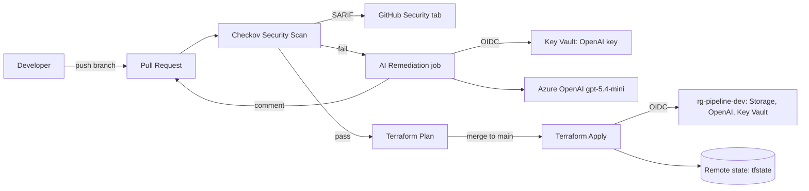
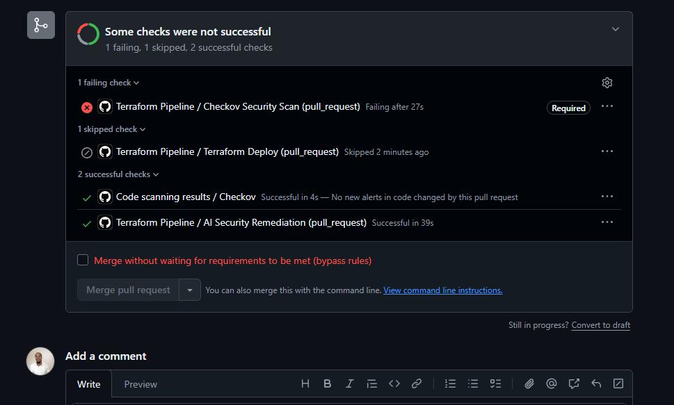
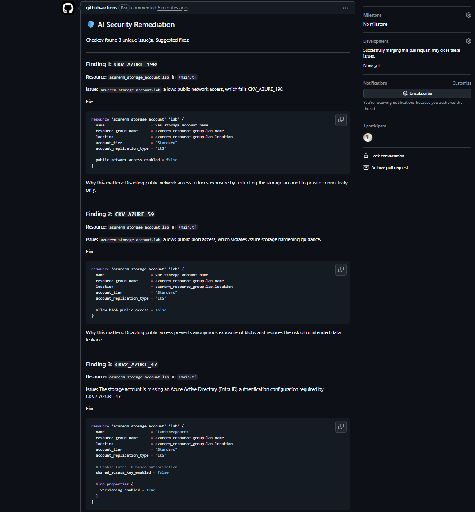
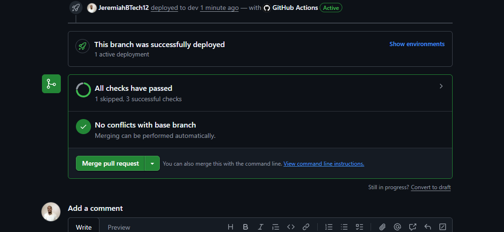
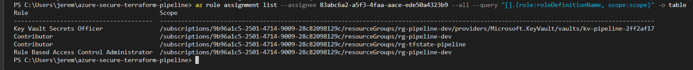

# Azure-Secure-Terraform-Pipeline

**Video Walkthrough:** <!-- LOOM LINK HERE -->
**Jeremiah Brown | Azure Cloud Engineer | [LinkedIn](https://www.linkedin.com/in/jeremiah-brown12/)**

A security-gated CI/CD pipeline that deploys Azure infrastructure with Terraform, blocks insecure changes with Checkov, and uses Azure OpenAI to post fix suggestions on pull requests.

`Azure` `Terraform` `GitHub Actions` `Checkov` `OIDC` `Azure OpenAI` `Python`

Every pull request is scanned for security misconfigurations before it can merge. If the scan fails, the merge is blocked, and an AI job reads the findings and comments on the PR with suggested Terraform fixes. The pipeline signs in to Azure with OIDC, so no passwords or client secrets are stored anywhere, and its permissions are scoped to only the resource groups it manages.

## At a glance

|                      |                                                                                                                                |
| -------------------- | ------------------------------------------------------------------------------------------------------------------------------ |
| **Business problem** | Infrastructure changes that skip review can expose data publicly, and stored cloud credentials in CI are a common breach path. |
| **What I built**     | A GitHub Actions pipeline: Checkov security gate → AI remediation on failure → Terraform plan on PRs → apply on merge to main. |
| **Infrastructure**   | Storage account, Azure OpenAI with a model deployment, and Key Vault, all in Terraform with remote state in Azure Storage.     |
| **Security**         | OIDC federated credentials (no secrets), branch protection, least-privilege RBAC, OpenAI key read from Key Vault at runtime.   |
| **Proof it works**   | A PR that made storage public was blocked, the AI posted 3 fixes, and the fix PR went green and merged. See Screenshots.       |
| **Debugging record** | Real issues, each with root cause and fix, in `docs/TROUBLESHOOTING.md`.                                                       |

## Project overview

Teams that let anyone push infrastructure straight to production eventually ship a public storage account or an open firewall rule. Pipelines that log in to the cloud with a stored client secret create another risk: one leaked secret can expose the whole subscription.

This project shifts security left. Problems are caught on the pull request, before anything is deployed, and the pipeline itself holds no long-lived credentials.

## System capabilities

- **Security gate:** Checkov scans every PR. Any failed check blocks the merge through branch protection.
- **Documented exceptions:** Checks that don't fit the environment are skipped in code with a written reason, so reviewers can see why.
- **AI remediation:** When the scan fails on a PR, a job sends the findings to Azure OpenAI and posts suggested HCL fixes as a PR comment.
- **Passwordless auth:** GitHub Actions authenticates to Azure with OIDC federated credentials. No client secrets exist.
- **Runtime secret retrieval:** The OpenAI key lives in Key Vault. The AI job pulls it at runtime and masks it in logs.
- **Plan on PR, apply on merge:** PRs show exactly what will change. Only a merge to main can apply.
- **Least privilege:** The pipeline identity has Contributor only on its two resource groups.
- **Security results in GitHub:** Checkov output is uploaded as SARIF to the repo's Security tab.

## What gets built

```
rg-pipeline-dev
├── Storage Account         → private, soft delete, SAS expiry policy
├── Azure OpenAI Account    → system-assigned identity, outbound restricted
│   └── gpt-deployment      → gpt-5.4-mini (GlobalStandard)
└── Key Vault (RBAC)        → purge protection, holds the OpenAI API key

rg-tfstate-pipeline
└── Storage Account         → remote Terraform state (container: tfstate)

Microsoft Entra ID
└── App registration + service principal → OIDC federated credentials
                                           for main, pull requests and the dev environment
```

## Pipeline flow



1. A pull request triggers **Checkov Security Scan**. Results upload to GitHub Security as SARIF.
2. If the scan fails, the merge is blocked and **AI Security Remediation** runs. It logs in with OIDC, reads the OpenAI key from Key Vault, and posts suggested fixes on the PR.
3. If the scan passes, **Terraform Deploy** runs init, fmt check, validate and plan.
4. On merge to main, the same job applies the plan.

## Screenshots

**Insecure change blocked:** a PR that opened the storage account to the internet failed the scan, and merge was disabled.



**AI remediation comment:** the pipeline posted suggested Terraform fixes for each finding.



**Fixed and green:** after applying the fix, all checks passed.



**Least privilege:** the pipeline identity only holds roles on its two resource groups.



## Repository structure

```
.
├── .github/workflows/terraform.yml   # Scan → AI remediation → plan/apply
├── terraform/
│   ├── versions.tf                   # Terraform and provider versions
│   ├── backend.tf                    # Remote state in Azure Storage
│   ├── variables.tf
│   ├── main.tf                       # Storage, OpenAI, Key Vault
│   └── outputs.tf
├── scripts/remediate_ai.py           # Checkov JSON → Azure OpenAI → PR comment
├── requirements.txt
├── .vscode/settings.json             # Format on save for Terraform and YAML
└── docs/TROUBLESHOOTING.md           # Real issues: error, root cause, fix
```

## Deploy it yourself

**Prerequisites:** an Azure subscription with Azure OpenAI access, Terraform 1.7+, Azure CLI, and a GitHub repo.

1. **Bootstrap remote state** with Azure CLI. Create a resource group, a storage account and a `tfstate` container, then put the account name in `terraform/backend.tf`.
2. **Create the pipeline identity.** Make an app registration and service principal, then add federated credentials for `ref:refs/heads/main`, `pull_request` and `environment:dev`. Check the subject GitHub actually sends, since newer repos use an ID-based format (see Troubleshooting).
3. **Grant roles:** Contributor on the app and state resource groups, and Role Based Access Control Administrator on the app resource group.
4. \*\*
